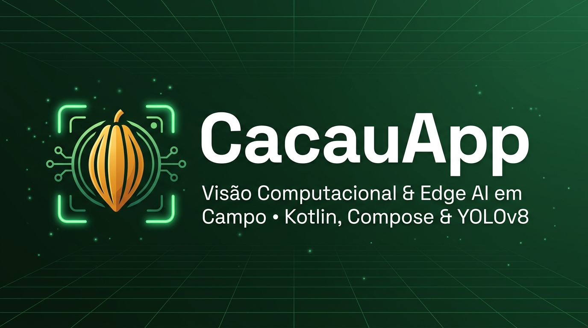
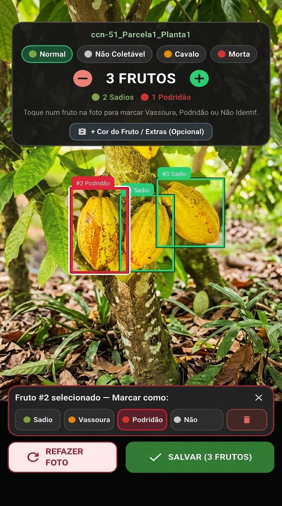
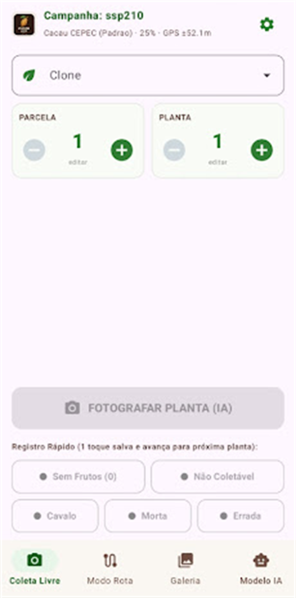

<div align="center">
  
</div>

# 📱 CacauApp — Android Nativo Offline-First & Inferência YOLOv8 On-Device

<p align="center">
  <a href="https://github.com/Igor8818/CacauApp/actions/workflows/android-ci.yml">
    
  </a>
  
  
  
  
  
</p>

Aplicativo Android nativo **100% Offline-First** de **Visão Computacional On-Device**, projetado em **Kotlin 2.0 + Jetpack Compose + CameraX + TensorFlow Lite** para executar inferência em tempo real com **pipeline duplo de modelos YOLOv8**, revisão vetorial *Human-in-the-Loop* pós-captura e sincronização em lote resiliente em cenários críticos sem internet.

> 🔗 **Arquitetura Cliente-Servidor Completa:** Sincroniza de forma idempotente (via auto-descoberta HTTP/Wi-Fi `/24` ou túnel reverso **USB ADB**) com a [**CacauSync API**](https://github.com/Igor8818/CacauSync) (**Java 21 + Spring Boot 3 + React 18 + PostgreSQL**).  
> 🧬 **Runtime Open-Source Desacoplado:** Conheça também o [**BreedAI**](https://github.com/Igor8818/BreedAI), evolução *open-source* (MIT) deste motor com leitura nativa de `.xlsx` e suporte plugável a qualquer modelo `.tflite`.

---

## 📸 Interface e Telas em Campo

<div align="center">
  <table>
    <tr>
      <td align="center" width="50%">
        <b>Detecção Fitossanitária com IA & Revisão Interativa</b><br/><br/>
        
      </td>
      <td align="center" width="50%">
        <b>Operação de Coleta em Campo & Modo Rota</b><br/><br/>
        
      </td>
    </tr>
  </table>
</div>

---

## 🎯 Problema do Mundo Real & Solução de Campo

Pesquisadores e técnicos agrícolas do CEPEC avaliam rotineiramente centenas de plantas em ensaios como o **TC-1801** (940 plantas e 104 clones). No campo, não há conectividade com a internet, e a anotação manual em papel gera erros de contagem, transcrição e falta de padronização fitossanitária.

O **CacauApp** resolve este gargalo ao unificar **visão computacional local**, **revisão auditável em tela cheia (*Human-in-the-Loop*)** e **sincronização idempotente em 1 clique** com o laboratório.

---

## ✨ Funcionalidades Principais

* **⚡ Pipeline Duplo (Contagem + Diagnóstico CEPEC) & Dois Modelos YOLOv8 Embutidos:**
  * `Modo Combinado`: Executa `detector.tflite` para contagem no preview e aplica `detector_doenca.tflite` + `refinarClasseDoencaPorMorfologiaCor` na revisão pós-foto (*Human-in-the-Loop*) para distinguir frutos vassourados necrosados, podridão parda, monilíase e sadios sem perder detecções.
  * `detector_doenca.tflite` (**Cacau Doenças CEPEC**) & `detector.tflite` (**Cacau Contagem CEPEC**) também podem ser selecionados individualmente na configuração do modelo.
  * Suporte a modelos externos `.tflite`, pré-processamento por **Letterbox isomórfico (`640x640`)**, aceleração multithread em CPU + GPU Delegate e re-inferência estática pós-captura para **snap geométrico** exato sobre a foto estática.
* **🔍 Tela de Revisão Pós-Captura em Tela Cheia (*Human-in-the-Loop*):**
  * Toque inteligente selecionando o centro do fruto mais próximo em cachos densos para classificar:
    * 🟢 **Sadio** | 🟠 **Vassoura de Bruxa** | 🔴 **Podridão Parda** | ⚪ **Não Avaliável**
  * Adição manual de frutos com 1 toque, ajuste de tamanho (`−` / `+`) e botão explícito **`🗑 Excluir`** com proteção contra duplicação (*anti-ressurreição*).
* **🌱 Catálogo Nativo dos 104 Clones do CEPEC (`ClonesCepec.kt`) + Navegação Rápida:**
  * Autocompletar na aba Coleta Manual com autopreenchimento inteligente de Parcela e Planta a partir da rota carregada e botões diretos `−` / `+` nos contadores de **Parcela** e **Planta**.
* **🗺️ Modo Rota Inteligente (Planejamento 1-Clique PC ↔ Celular):**
  * Hot-reload de `files/rota_precarregada.json` via cabo USB ADB, botão **`Atualizar do PC`** direto da API **CacauSync** ou importação local de planilhas `.csv` na ordem exata (`#1 → #N`).
* **🔌 Sincronização 1-Clique Zero-Config (`CacauSyncClient`):**
  * Auto-descoberta via ponte USB ADB (`127.0.0.1:8080`) ou scan Wi-Fi `/24`, autenticação JWT Bearer, envio em lote `POST /api/v1/coletas/sync-json` com caixas normalizadas (`0.0`–`1.0`) e upload multipart de fotos JPEG com correção EXIF e proteção anti-OOM.
* **📊 Exportação Offline RFC 4180:** Geração imediata de CSV UTF-8 em `Download/CEPEC`.

---

## 🛠️ Stack Tecnológica

| Camada | Tecnologias Utilizadas |
|---|---|
| **Linguagem & Plataforma** | Kotlin `2.0.21`, Android SDK (`minSdk 24`, `targetSdk 36`, AGP `9.0.0`) |
| **Interface de Usuário** | Jetpack Compose, Material Design 3, Material Icons Extended, Coil `2.6.0` |
| **Câmera & Visão Computacional** | CameraX `1.5.3`, TensorFlow Lite `2.16.1` (+ GPU Delegate), YOLOv8 (`640x640` Float32) |
| **Rede & Sincronização** | OkHttp `4.12.0`, JSON nativo Android, Network Security Config |
| **Geolocalização & Hardware** | Google Play Services Location `21.2.0` (`FusedLocationProviderClient`), ExifInterface |
| **Qualidade & CI** | JUnit 4 (**33 testes unitários**), Mockito `5.11.0`, GitHub Actions CI |

---

## 🏛️ Engenharia de Software & Governança por Especificações (SDD)

Este projeto segue **Spec-Driven Development (SDD)** com auditoria por subagentes de contexto zero:
* **[`docs/REGRAS_DE_NEGOCIO.md`](docs/REGRAS_DE_NEGOCIO.md):** Regras agronômicas de campo (`RN-MOB-01` a `RN-MOB-05`) e laboratório (`RN-BACK-01` a `RN-BACK-05`).
* **Contratos Formais Cross-Stack ([`docs/specs/`](docs/specs/)):**
  * `SPEC-000`: Matriz de concordância Mobile ↔ API ↔ CSV ↔ Web.
  * `SPEC-001`: Sincronização idempotente, EXIF e memória.
  * `SPEC-002`: Letterbox isomórfico (YOLO), projeção inversa e ergonomia da câmera.
  * `SPEC-003`: Fórmulas de produtividade líquida clonal (`kg/ha` e `@/ha`).
* **[`AGENTS.md`](AGENTS.md) & [`.agents/skills/`](.agents/skills/):** Protocolos de auditoria cega com zero viés.

---

## 🏗️ Como Compilar, Testar e Instalar

```bash
git clone https://github.com/Igor8818/CacauApp.git
cd CacauApp
./gradlew testDebugUnitTest assembleDebug --no-daemon
```

No Windows PowerShell (com JDK do Android Studio):

```powershell
$env:JAVA_HOME = "C:\Program Files\Android\Android Studio\jbr"
.\gradlew.bat testDebugUnitTest assembleDebug --no-daemon
adb install -r app\build\outputs\apk\debug\app-debug.apk
```

### Suíte de Testes Unitários (**33 Testes Passing**)
* `CsvParsingUnitTest` (4) • `DomainConcordanceIntegrationTest` (4) • `LetterboxAndGeometryUnitTest` (9) • `ModelAndStateUnitTest` (8) • `YoloDetectionAndScaleUnitTest` (8).

---

## 👨‍💻 Autor

**Igor Sena Hagge**  
Engenheiro de Software | Android (Kotlin) & Back-end Java & AI Engineering  
* **GitHub:** [@Igor8818](https://github.com/Igor8818)  
* **LinkedIn:** [linkedin.com/in/igorhagge](https://www.linkedin.com/in/igorhagge/)  
* **E-mail:** [igor.senna2@hotmail.com](mailto:igor.senna2@hotmail.com)
