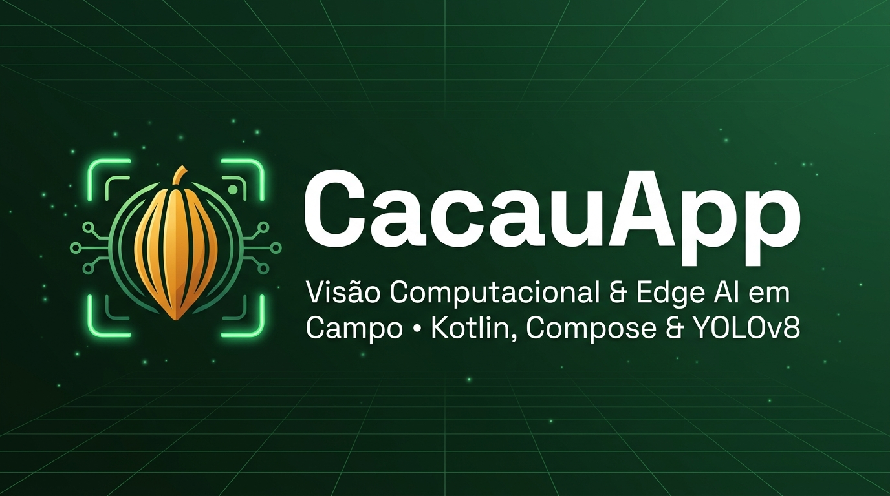
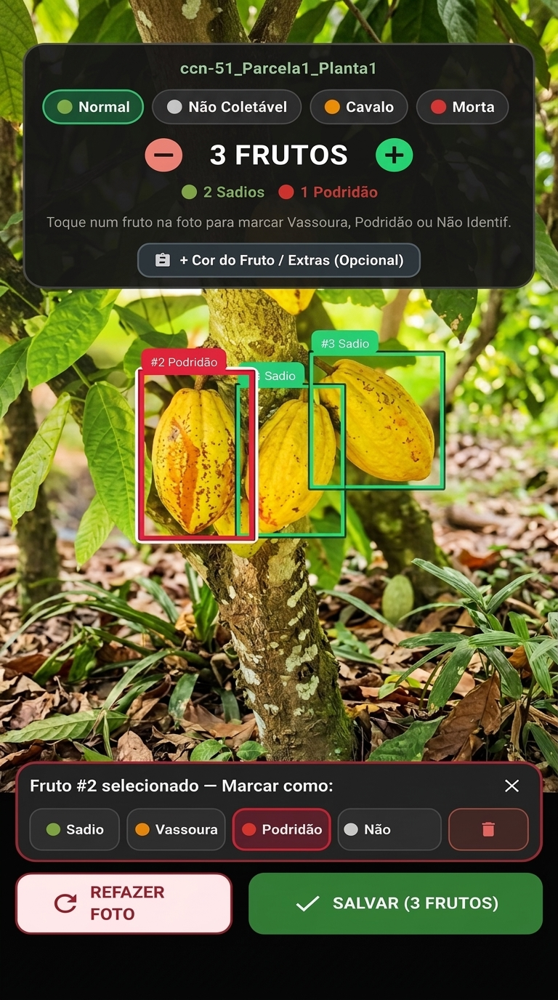
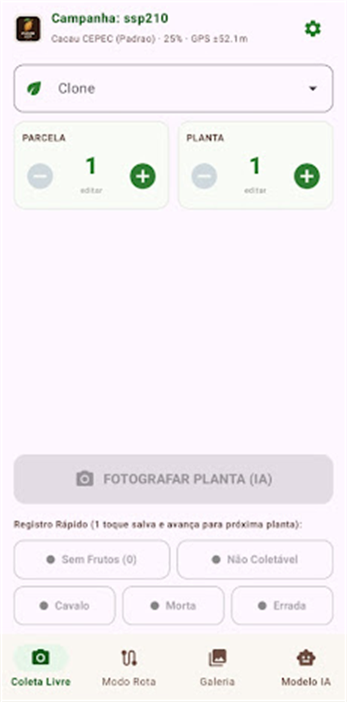

<div align="center">
  
</div>

# 📱 CacauApp — Visão Computacional Embarcada & Auditoria Fenotípica Offline

[](https://kotlinlang.org)
[](https://developer.android.com)
[](https://developer.android.com/jetpack/compose)
[](https://www.tensorflow.org/lite)
[](https://www.gov.br/agricultura/pt-br/assuntos/ceplac)

Aplicativo Android nativo de **Edge AI** (inteligência artificial on-device) desenvolvido para o **Centro de Pesquisas do Cacau (CEPEC / CEPLAC)** em Ilhéus/Itabuna - BA. 

O sistema opera **100% offline** em quadras experimentais de melhoramento genético, realizando a detecção, classificação fitossanitária e contagem de frutos de cacau diretamente pela câmera do smartphone com auxílio de modelos de deep learning (**YOLOv8**).

> 🔗 **Ecossistema Completo:** Este aplicativo se integra diretamente com a [**CacauSync API**](https://github.com/Igor8818/CacauSync), back-end em **Java 21 + Spring Boot 3 + PostgreSQL**, para ingestão em lote de coletas de campo, upload de fotos auditadas e ranqueamento de produtividade clonal.

---

## 📸 Interface e Telas em Campo

<div align="center">
  <table border="0">
    <tr>
      <td align="center" width="50%">
        <b>Detecção Fitossanitária com IA & Revisão Interativa</b><br/><br/>
        
      </td>
      <td align="center" width="50%">
        <b>Operação de Coleta em Campo & Modo Rota</b><br/><br/>
        
      </td>
    </tr>
  </table>
</div>

---

## 🎯 Problema do Mundo Real & Solução de Campo

Pesquisadores e técnicos agrícolas do CEPEC avaliam rotineiramente milhares de plantas em ensaios como o **TC-1801**. No campo, não há conectividade com a internet, e a anotação manual em pranchetas de papel resulta em:
1. Erros de contagem e transcrição;
2. Falta de padronização visual no diagnóstico fitossanitário (*Sadio*, *Vassoura de Bruxa*, *Podridão Parda*);
3. Desalinhamento entre registros de mortalidade e produtividade real.

O **CacauApp** resolve este gargalo ao unificar **visão computacional local**, **tela de revisão auditável pelo pesquisador** e **georreferenciamento instantâneo via GPS**.

---

## ✨ Funcionalidades Principais

* **⚡ Inferência de Edge AI em Tempo Real + Snap Geométrico Pós-Captura (YOLOv8 Float32):**
  * Detecção on-device a 30+ FPS via **TensorFlow Lite Interpreter** com 4 threads de CPU e suporte a aceleração gráfica GPU Delegate.
  * Mapeamento matemático em aspecto fixo 4:3 (`Preview` e `ImageAnalysis`) e **re-inferência estática de alta resolução pós-disparo** sobre a foto capturada (`ObjectDetectorHelper.detectStaticImage`), eliminando qualquer desalinhamento entre o preview e o clique do obturador (testado em Xiaomi Redmi Note 13 Pro 5G e Samsung Galaxy A50).
* **🔍 Tela de Revisão Pós-Captura em Tela Cheia (Modo Imersivo Human-in-the-Loop):**
  * Interface imersiva em tela cheia (tanto na captura da câmera quanto na análise de fotos da galeria) onde o pesquisador toca no fruto (seleção inteligente da caixa mais próxima em cachos densos) para classificá-lo:
    * 🟢 **Sadio**
    * 🟠 **Vassoura de Bruxa** (*Moniliophthora perniciosa*)
    * 🔴 **Podridão Parda** (*Phytophthora palmivora*)
    * ⚪ **Não Avaliável**
  * Toque em áreas vazias da foto para adicionar frutos não detectados manualmente com 100% de confiança;
  * Controles dedicados e visíveis para **ajuste fino de tamanho (`−` Diminuir / `+` Aumentar)** e **botão explícito `🗑 Excluir`** para remoção imediata de marcações acidentais ou falsos positivos;
  * Resumo biométrico consolidado em tempo real por planta.
* **🌱 Catálogo Nativo com os 104 Clones Reais do CEPEC (`ClonesCepec.kt`):**
  * Autocompletar instantâneo na aba de Coleta Manual com todos os **104 clones oficiais do ensaio competitivo `TC-1801`** (incluindo séries `RB`, `CC`, `CEPEC`, `CCN-51`, `PS-13.19`, `PH-16`, `SJ-02`, `BN-34`, `TSA`, `TSH` e `VB`), eliminando erros de digitação em campo.
* **🗺️ Modo Rota Inteligente (Planejamento 1-Clique PC ↔ Celular):**
  * **Hot-Reload via Cabo USB:** Recebe automaticamente a planilha de rota enviada pelo pesquisador no PC (`files/rota_precarregada.json`) assim que a aba *Modo Rota* é aberta;
  * **Botão `"PUXAR PLANILHA DO PC (1 CLIQUE)"`:** Baixa a rota atualizada diretamente da **CacauSync API** via cabo USB ou Wi-Fi local, ou permite importar arquivos `.csv` do aparelho;
  * Navegação sequencial na **Ordem Exata da Planilha (`#1 → #N`)** por Parcela, Bloco, Planta e Clone, com avanço automático para a próxima planta pendente após cada foto auditada.
* **🔌 Sincronização 1-Clique Zero-Config com o Laboratório (`CacauSyncClient`):**
  * **Auto-Descoberta Inteligente (USB ADB Reverse + Scan Wi-Fi `/24`):** O botão `"SINCRONIZAR COM PC (1 CLIQUE)"` localiza automaticamente o servidor **CacauSync** via cabo USB (`127.0.0.1:8080`) ou varredura paralela na rede Wi-Fi local sem exigir digitação de IP nem seleção manual de arquivos;
  * Autenticação automática JWT Bearer (`POST /api/v1/auth/login`), envio em lote das coletas com caixas YOLO normalizadas (`0.0` a `1.0`) via `POST /api/v1/coletas/sync-json` e upload assíncrono das fotos auditadas com compressão inteligente (JPEG 85%, máx 1600px) e proteção contra *OutOfMemoryError*.
* **📊 Exportação Offline em Planilha (RFC 4180):**
  * Geração instantânea de arquivo CSV padronizado no diretório `Download/CEPEC` com codificação UTF-8 e escape seguro de caracteres especiais.

---

## 🛠️ Stack Tecnológica

| Camada | Tecnologias Utilizadas |
|---|---|
| **Linguagem & Plataforma** | Kotlin 2.0, Android SDK (minSdk 24, targetSdk 36) |
| **Interface de Usuário** | Jetpack Compose, Material Design 3, Icons Extended, Coil Compose |
| **Câmera & Visão Computacional** | CameraX 1.5.3, TensorFlow Lite 2.16.1, YOLOv8 (640x640 Float32) |
| **Comunicação de Rede** | OkHttp 4.12.0, JSON nativo Android, Network Security Config |
| **Geolocalização & Hardware** | Google Play Services Location (FusedLocationProviderClient), ExifInterface |
| **Arquitetura** | MVVM, StateFlow, Coroutines assíncronas, SnapshotStateList, Concorrência Blindada |

---

## 🏛️ Engenharia de Software & Governança por Especificações (SDD)

Este projeto foi construído seguindo os mais altos padrões de **Engenharia de Software Moderna**:

* **Fonte Primária de Verdade Agronômica ([`docs/REGRAS_DE_NEGOCIO.md`](docs/REGRAS_DE_NEGOCIO.md)):** Regras de negócio estritas de campo (`RN-MOB-01` a `RN-MOB-05`) que determinam a primazia da revisão humana fitossanitária sobre a inferência bruta da IA.
* **Contratos Formais Cross-Stack ([`docs/specs/`](docs/specs/)):**
  * `SPEC-000`: Matriz de concordância técnica Mobile ↔ API ↔ CSV ↔ Web.
  * `SPEC-001`: Protocolo de sincronização idempotente e gerenciamento de memória.
  * `SPEC-002`: Algoritmo matemático de Letterbox isomórfico (YOLO) e projeção de coordenadas.
  * `SPEC-003`: Fórmulas de produtividade líquida comercial (kg/ha e @/ha) para clones de cacaueiro.
* **Auditoria Contínua por Subagentes de Contexto Zero ([`AGENTS.md`](AGENTS.md)):** Validação automatizada por múltiplos subagentes de IA especializados que auditam concorrência, conformidade matemática e segurança sem viés.
* **Testes Automatizados de Ponta a Ponta:** Suíte de testes unitários cobrindo geometria, NMS, parsing RFC 4180 e contratos de domínio com o back-end.

---

## 🏗️ Como Compilar e Instalar

### Pré-requisitos
* Android Studio (versão Ladybug / Koala ou superior) com JDK 21 (JetBrains Runtime JBR);
* Aparelho físico Android com modo de depuração USB ativo.

### 1. Clonar o repositório
```bash
git clone https://github.com/Igor8818/CacauApp.git
cd CacauApp
```

### 2. Compilar o APK de Debug via Gradle
```powershell
$env:JAVA_HOME = "C:\Program Files\Android\Android Studio\jbr"
.\gradlew assembleDebug
```

### 3. Instalar no aparelho via ADB
```powershell
adb install -r app/build/outputs/apk/debug/app-debug.apk
```

---

## 👨‍💻 Autor

**Igor Hagge**  
Engenheiro de Software | Android (Kotlin) & Back-end Java & AI Engineering  
* **GitHub:** [@Igor8818](https://github.com/Igor8818)  
* **LinkedIn:** [linkedin.com/in/igorhagge](https://www.linkedin.com/in/igorhagge/)  
* **E-mail:** [igor.senna2@hotmail.com](mailto:igor.senna2@hotmail.com)
